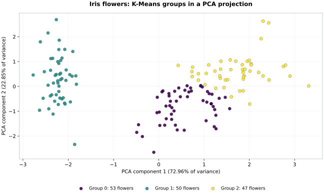

# AI Engineering Foundations

Four Python applications, supported by examples in local model inference, tool-using agents and machine learning.

The projects connect APIs, databases and models to concrete tasks: managing customer requests, routing support messages, answering questions with tools and processing images. The focus is on the application around the model—validating inputs, executing permitted actions, saving results and handling failures.

## Core applications

| Project | Stack | What it implements |
| --- | --- | --- |
| [Customer Requests API](projects/fastapi_01_customer_requests/README.md) | FastAPI, Pydantic, SQLite | Create, retrieve, update and delete requests; validate bodies and IDs; paginate records; preserve data across restarts |
| [ML Ticket-Routing API](projects/fastapi_02_ml_prediction_api/README.md) | pandas, scikit-learn, Joblib, FastAPI, SQLite | Clean support messages, train a TF-IDF/logistic-regression classifier for 11 categories, serve the saved model and store predictions for retrieval |
| [LLM Tools API](projects/fastapi_03_llm_tools_api/README.md) | Groq, FastAPI, Pydantic, SQLite | Connect a hosted language model to a fictional order lookup, validate tool arguments and JSON replies, and save conversations and tool traces together |
| [Computer Vision](projects/computer_vision_demo/README.md) | OpenCV, YuNet, DeepFace, ArcFace | Resize and convert images, detect faces, and compare two face embeddings using cosine distance |

Each application has its own README with setup instructions, API or script examples, test commands and implementation limits.

The ticket classifier correctly labels **3,631/3,642 final-test messages (99.70%)**, against a **22.08% baseline** on the same hybrid synthetic corpus. The [evaluation report](projects/fastapi_02_ml_prediction_api/EVALUATION.md) explains the split, metrics and unsupported-input limitation.

## Model and agent examples

### Local pretrained models

[Pretrained Model Demos](projects/pretrained_model_demos/README.md) contains two ways to run an existing model locally:

- **DistilBERT sentiment classification:** Transformers loads the tokenizer and checkpoint; PyTorch runs predictions on the CPU. The script checks blank inputs and token limits before prediction.
- **Qwen3 through Ollama:** a standard-library Python client sends a JSON request to Ollama's local API, bounds the context and output, and checks that the reply completed normally.

Model sources, versions, download checksums and runtime limitations are documented with the demos.

### ReAct-style tool agent

[The agent project](projects/llm_agent_demos/README.md) connects a Groq-hosted model to local Python multiplication. A manual version pauses before executing a tool; an automatic version continues through tool requests and results until it answers or reaches its execution limit.

The application validates the requested function and arguments before execution. The model receives the actual Python result and can use it in its next action. For example:

```text
Tool call 1: multiply(18, 24) -> 432
Tool call 2: multiply(432, 3) -> 1296
Final answer: The total cost is 1296 dollars.
```

## Machine learning notebook

[ml_revision.ipynb](notebooks/ml_revision.ipynb) explores the Iris dataset through data inspection, a supervised baseline comparison, K-Means clustering and PCA. It includes explanations, executed outputs and a chart.

The decision tree correctly classifies **29/30 test flowers**, compared with **10/30** for the baseline. A separate exploratory exercise groups all 150 flowers by their standardized measurements and projects them into two PCA coordinates.



Each dot is one flower. Position comes from PCA; color comes from K-Means. The two coordinates retain **95.8% of standardized variance**; this is separate from classification accuracy. See the [notebook guide](notebooks/README.md) for setup and interpretation.

## Technologies

- **APIs and storage:** FastAPI, Uvicorn, Pydantic, SQLite.
- **Machine learning and analysis:** pandas, scikit-learn, Joblib, Matplotlib, Jupyter.
- **Language models:** PyTorch, Transformers, Groq, Ollama.
- **Computer vision:** OpenCV, YuNet, DeepFace, ArcFace, ONNX Runtime.
- **Testing:** pytest, unittest and controlled model/provider responses.

## Run locally

Use Python 3.12 and a separate environment for each project. The Customer Requests API is the quickest starting point because it needs no model download or API key. It requires SQLite 3.35 or later.

```bash
git clone https://github.com/karimk223/ai-engineering-study-log.git
cd ai-engineering-study-log/projects/fastapi_01_customer_requests

python3.12 -m venv .venv
source .venv/bin/activate
python -m pip install -r requirements.txt
python -m pytest -q
python -m uvicorn app.main:app --reload --host 127.0.0.1 --port 8000
```

Open [Swagger UI](http://127.0.0.1:8000/docs) to try the routes. The commands above use macOS/Linux activation syntax.

The three APIs use ports **8000**, **8001** and **8002**. Follow the relevant project README for model preparation, a private Groq key or Ollama setup. Dependencies and configuration differ between projects; there is no shared repository-wide environment. Datasets, model weights, private photos, credentials and generated databases are kept out of Git.

## Testing and scope

The API suites contain **51**, **16** and **56** passing cases respectively. The computer-vision, pretrained-model and agent projects each have **8** passing application tests. They cover validation, persistence, controlled model/tool interactions and selected failure paths; they are not general model-accuracy benchmarks. Each README records the test commands and environment verification details.

These are local applications and integration examples, with no implemented user authentication or production deployment. Dataset and model limitations—including unsupported ticket categories, the sentiment demo's single-input runtime issue and unwanted Ollama planning text—are described in the relevant project READMEs. Technical notes explain the main concepts and design choices.
